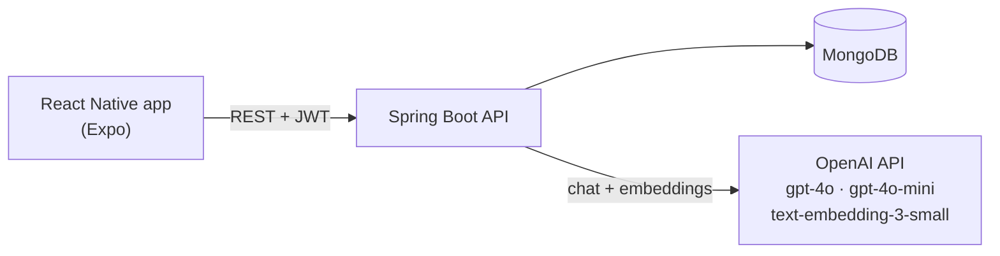

# One Percent: Spring Boot Backend

REST API for **One Percent**, a self-development app for habit tracking and reflective journaling, with personalised feedback from a large language model. Built as my final year project (BSc Computer Science, Birmingham City University, 2025).

The companion mobile app lives here: **[fyp_one_percent (React Native / Expo)](https://github.com/kailau1/fyp_one_percent)**

## What it does

- **Accounts and auth:** registration and login with JWT-secured endpoints (Spring Security)
- **Journaling:** create, edit, delete and list journal entries; each entry is embedded on save
- **AI feedback:** personalised, context-aware feedback on journal entries (OpenAI `gpt-4o`)
- **Theme detection:** works out what a user writes about most, using embeddings and cosine similarity
- **Personalised prompts:** 6–8 journaling prompts generated from the user's habits and recurring themes
- **Tip of the day:** a short daily self-improvement tip (`gpt-4o-mini`)
- **Habits:** standard habits and "trigger → action" habits (*"When I [trigger], I will [action]"*), daily completion tracking and history, reset every midnight by a scheduled job

## Architecture



Layered structure: **controllers → services → repositories**, with DTOs and MapStruct mappers between the API and the domain models.

## How the AI feedback works

The interesting part of the project is making feedback feel personal rather than generic, and stopping it from repeating itself.

1. **Embed every entry.** When a journal entry is saved, its text is embedded with `text-embedding-3-small` and stored alongside it in MongoDB.
2. **Detect recurring themes.** Ten themes (e.g. procrastination, self-doubt, burnout, gratitude) are each represented by an embedding of a descriptive first-person passage, generated once by `ThemeEmbeddingGenerator` and loaded from `themes.json`. Each entry is compared to every theme by cosine similarity; the **top 3** themes per entry are counted, and the user's **3 most frequent** themes become context.
   *Design note: I originally used a fixed similarity threshold, but evaluation showed cosine scores varied too much between entries for a single cut-off to work, so I switched to top-k ranking.*
3. **Build user context.** The user's recently active habits (updated in the last 7 days) and frequent themes are added to the prompt.
4. **Avoid repeating advice.** The 3 past entries most similar to the current one are retrieved by cosine similarity, and short summaries of the feedback they received (generated by `gpt-4o-mini`) are passed in with an instruction not to repeat them. If no similar entries exist, it falls back to the 3 most recent.
5. **Generate feedback.** `gpt-4o` (temperature 0.7, ~140-word limit) responds as a warm, practical coach: reflecting what the user actually said and suggesting one concrete, psychologically grounded strategy.

Relevant code: `service/ai/AiService.java`, `service/embedding/EmbeddingService.java`, `util/ContextUtil.java`, `service/ai/PromptService.java`.

## API overview

All endpoints except register, login and Swagger require a `Bearer` JWT.

| Area | Endpoints |
| --- | --- |
| Users | `POST /api/users/register` · `POST /api/users/login` |
| Journals | `GET /api/journals/me` · `POST /api/journals` · `GET /api/journals/entry/{id}` · `PUT /api/journals/entry` · `DELETE /api/journals/{id}` |
| Habits | `POST /api/habits/create` · `GET /api/habits/me` · `PUT /api/habits/update` · `DELETE /api/habits/delete/{id}` |
| Habit history | `GET /api/habit-history/today` · `GET /api/habit-history/{habitId}` · `POST /api/habit-history/complete/{habitId}` · `POST /api/habit-history/uncomplete/{habitId}` |
| AI | `POST /api/ai/feedback` · `GET /api/ai/tip` · `GET /api/ai/prompt/{userId}` |

Interactive docs are available via Swagger UI (springdoc) once the app is running.

## Tech stack

Java 17 · Spring Boot 3.1 · Spring Security · JWT (jjwt) · Spring Data MongoDB · MapStruct · Lombok · OkHttp · springdoc-openapi · Spring Actuator · Maven

## Running locally

### Prerequisites
- Java 17
- Maven
- MongoDB (local or Atlas)
- An OpenAI API key

### 1. Clone
```bash
git clone https://github.com/kailau1/fyp_one_percent_spring
cd fyp_one_percent_spring
```

### 2. Configure
`application.properties` is gitignored so secrets never reach the repo. Create `src/main/resources/application.properties`:

```properties
spring.data.mongodb.uri=mongodb://localhost:27017/one_percent
server.port=8084
# Use 0.0.0.0 so the mobile app on your phone can reach the API over your local network
server.address=0.0.0.0

jwt.secret=<a long random secret>
openai.api.key=<your OpenAI API key>

springdoc.swagger-ui.path=/swagger-ui.html
springdoc.api-docs.path=/api-docs
```

### 3. Run
```bash
mvn spring-boot:run
```
The API starts on `http://localhost:8084`. Swagger UI: `http://localhost:8084/swagger-ui.html`.

Then point the [mobile app](https://github.com/kailau1/fyp_one_percent) at your machine's local IP address.

## What I'd improve next

Being honest about where this project would go with more time:

- **Testing:** the current tests are exploratory integration tests that call the real database and OpenAI. I'd add unit tests for the similarity and context-building logic with a mocked `OpenAIClient`, so they're fast, free and deterministic.
- **Authorisation checks:** fetching or deleting a journal by ID should verify that the entry belongs to the authenticated user.
- **Remove the test endpoint:** `/api/test-ai` is open without authentication for development; it should be removed or secured.
- **Logging and resilience:** replace remaining `System.out` calls with structured logging, reuse a single HTTP client, and add retries/timeouts around OpenAI calls.
